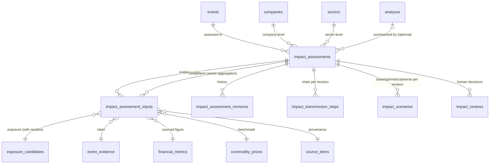
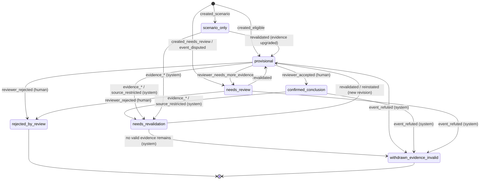

# Migration 0009 design: Phase 5 impact assessments

**Design only.**
- No SQL file is written. Migrations 0001–0008 are not modified.
- No database is altered. Production Turso is unchanged (0001–0005 applied; 0006–0008 not applied;
  verified read-only on 2026-11-07).
- Phase 5 is not started.

Based on `main` @ `c864af1` and the merged Phase 5 contract:
- `PHASE_5_DATA_CONTRACT.md`
- `PHASE_5_TRANSMISSION_FRAMEWORK.md`
- `PHASE_5_TEST_STRATEGY.md`
- `PHASE_5_IMPLEMENTATION_ROADMAP.md`

## 1. Current schema assessment
| Existing object | Relevant to Phase 5 | Gap |
|---|---|---|
| `events`, `event_revisions` (0002) | event input; `verification_state` includes `refuted`, `disputed`; append-only revisions | no link to assessments |
| `event_evidence` (0002) | claim evidence | — |
| `exposure_candidates*`, `exposure_candidate_evidence`, `exposure_reviews`, `evidence_retractions` (0008) | exposure input and evidence | — |
| `exposure_candidates_current`, `invalid_candidate_evidence` views (0008) | read-time validity | assessments must reuse them |
| `analyses` (0003) | versioned per-(event, company) summary; `label` qualitative/quantitative; one `confidence` | **no delete protection**; one confidence; no per-mechanism key; no evidence links; no status |
| `financial_metrics`, `commodity_prices` (0003) | sourced quantification inputs | — |
| `alerts_predictions`, `market_outcomes` (0003) | frozen theses, observed outcomes (Phase 14) | must stay separate from assessments |
| `sectors`, `company_classifications` (0001) | sector aggregation | — |
| `sources.is_synthetic` (0008) | synthetic marker | — |

**Decision:**
- Keep `analyses` unchanged, and add only a delete-protection trigger to it.
- Add new tables for per-mechanism assessments. Old rows stay valid.

## 2. Proposed objects (all additive)

| Object | Kind | Purpose |
|---|---|---|
| `impact_assessments` | table | one row per (event × company-or-sector × mechanism × scenario kind × transmission version); current state |
| `impact_assessment_inputs` | table | normalised FK links to every input; append-only |
| `impact_assessment_revisions` | table | immutable audit of every state; trigger-written |
| `impact_transmission_steps` | table | ordered chain steps per revision |
| `impact_scenarios` | table | base/optimistic/adverse framing per revision |
| `impact_reviews` | table | human decisions; append-only |
| `impact_invalid_inputs` | view | inputs that are currently invalid |
| `impact_assessments_current` | view | read model with `effective_status` and `data_label` |
| `trg_analyses_no_delete` | trigger on existing `analyses` | closes the 0003 gap |
| refutation propagation trigger | trigger on existing `events` | §6 |

**Not needed as separate objects:**
- a revalidation-request table: requests are review decisions or audit revisions;
- a confidence table: confidence is five columns with reasons;
- a mechanism table: the T1–T9 library is versioned code, and only `mechanism_id` plus
  `transmission_version` are stored.

## 3. Column-level design
Conventions follow 0002 and 0008:
- `INTEGER PRIMARY KEY`; timestamps are `TEXT` UTC `YYYY-MM-DDTHH:MM:SSZ` (`*_at_utc`);
- JSON columns `CHECK (json_valid(...))`;
- enumerations as `CHECK (... IN (...))`;
- every free text is non-blank.

### `impact_assessments`
| Column | Type / null | Rule |
|---|---|---|
| `assessment_id` | INTEGER PK | |
| `event_id` | INTEGER NOT NULL FK `events` | |
| `event_revision_no` | INTEGER NOT NULL | revision of the event used |
| `assessment_level` | TEXT NOT NULL | `company` · `sector` |
| `company_id` | TEXT NULL FK `companies` | required iff level = company |
| `sector_id` | TEXT NULL FK `sectors` | required iff level = sector |
| `mechanism_id` | TEXT NOT NULL | `GLOB 'T[1-9]'` (T1–T9) |
| `transmission_version` | TEXT NOT NULL | e.g. `transmission/1.0.0` |
| `ruleset_version` | TEXT NOT NULL | Phase 4 exposure rules used |
| `calculation_version` | TEXT NULL | only when quantified |
| `scenario_kind` | TEXT NOT NULL | `current` · `hypothetical` · `historical_test` |
| `assessment_status` | TEXT NOT NULL | §5 |
| `status_reason` | TEXT NOT NULL | §5 reason codes |
| `direction` | TEXT NOT NULL | `positive` · `negative` · `mixed` · `neutral` · `unknown` |
| `magnitude_level` | TEXT NOT NULL | `low` · `medium` · `high` · `not_assessable` |
| `magnitude_basis` | TEXT NOT NULL | `qualitative` · `deterministic_model` · `financially_quantified` |
| `horizon` | TEXT NOT NULL | `short` · `medium` · `long` · `unknown` |
| `evidence_confidence`, `exposure_confidence`, `direction_confidence`, `magnitude_confidence` | TEXT NOT NULL | `low` · `medium` · `high` |
| `scenario_uncertainty` | TEXT NOT NULL | `narrow` · `wide` · `undetermined` |
| `confidence_reasons_json` | TEXT NOT NULL | one reason per dimension |
| `affected_lines_json`, `counter_evidence_json`, `missing_inputs_json` | TEXT NOT NULL | JSON arrays |
| `quantification_json` | TEXT NULL | formula id, inputs, unit, result, sensitivity; NOT NULL iff basis = `financially_quantified` |
| `market_check` | TEXT NOT NULL | `CHECK (market_check = 'not_evaluable')` in 0009 |
| `analysis_id` | INTEGER NULL FK `analyses` | optional summary link |
| `is_synthetic` | INTEGER NOT NULL | 0/1 |
| `current_revision` | INTEGER NOT NULL ≥ 1 | |
| `last_review_id` | INTEGER NULL FK `impact_reviews` | |
| `change_reason`, `changed_by`, `actor_type` | TEXT NOT NULL | `actor_type` ∈ `human` · `system` |
| `created_at_utc`, `updated_at_utc` | TEXT NOT NULL | |

**Deliberately absent:** numeric impact scores, percentages, thresholds, price targets and
observed-reaction columns.

### `impact_assessment_inputs` (append-only)
| Column | Rule |
|---|---|
| `assessment_id` FK | |
| `input_kind` | `exposure_candidate` · `event_evidence` · `financial_metric` · `commodity_price` · `component_assessment` |
| `exposure_candidate_id` + `exposure_candidate_revision` | FK; the revision captured at link time |
| `event_evidence_id`, `financial_metric_id`, `commodity_price_id`, `component_assessment_id` | FKs; exactly one target per row (CHECK sum = 1) |
| `source_item_id` | NOT NULL FK (NULL only for `component_assessment`) |
| `step_no` | NULL or chain step it supports |
| `added_at_utc` | |

Validation triggers (Phase 4 pattern):
- The input must belong to the same event or company (sector members for sector level).
- The candidate revision must exist.
- A synthetic input can't be linked to a non-synthetic assessment.
- No links can be added to a terminal assessment.

### `impact_assessment_revisions` (append-only; written only by triggers)
- **Columns:** `assessment_id`, `revision_no` (PK pair), `recorded_at_utc`, `previous_status`,
  `new_status`, `status_reason`, `actor_type`, `actor`, `review_id` (NULL unless human),
  `snapshot_json` (full row), `input_snapshot_json` (input ids plus each one's validity at that moment).
- **Guards:** hand inserts are refused unless they are the current revision; no update or delete.

### `impact_transmission_steps`
- **Columns:** `assessment_id`, `revision_no`, `step_no` (PK); `from_variable`, `to_variable`, `sign`
  (`+1`, `-1`, `0`, NULL = unknown), `lag_horizon`, `explanation`.
- **Guards:** append-only. The assessment's direction must be `unknown` if any step sign is NULL. This
  is enforced by the engine, and checked by a trigger on status upgrade.

### `impact_scenarios`
- **Columns:** `assessment_id`, `revision_no`, `scenario_case` (`base`, `optimistic`, `adverse`) (PK);
  `direction`, `magnitude_level`, `assumptions_json`.
- **Guards:** append-only. These are qualitative scenarios, not forecasts; the editable simulator
  belongs to Phase 12.

### `impact_reviews` (append-only)
- **Columns:** `review_id` PK; `assessment_id` FK; `decision` (`accept`, `reject`,
  `request_revalidation`, `needs_more_evidence`); `reviewer` (≥ 2 characters); `notes` (non-blank);
  `decided_at_utc` (GLOB format); `status_at_decision`.
- **Guards:** `status_at_decision` must equal the current status. `accept` is allowed only from
  `provisional` with all inputs valid.

### Indexes
- **Unique key:** `ux_impact_identity` on (event_id, assessment_level, COALESCE(company_id,''),
  COALESCE(sector_id,''), mechanism_id, scenario_kind, transmission_version). This avoids the problem
  of NULLs in a UNIQUE constraint.
- **Lookups:** `ix_impact_company`, `ix_impact_sector`, `ix_impact_status`, `ix_impact_inputs_candidate`,
  `ix_impact_inputs_assessment`, `ix_impact_reviews_assessment`.

## 4. Constraints summary
| Constraint | Enforced by |
|---|---|
| Level ⇔ exactly one of company_id / sector_id | CHECK |
| `confirmed_conclusion` ⇔ accepted review referenced by `last_review_id` | CHECK + update trigger |
| `rejected_by_review` ⇔ `reject` review referenced, reason `reviewer_rejected` | update trigger |
| `withdrawn_*` statuses ⇔ evidence-driven reason codes only, actor `system` | CHECK (status↔reason table) |
| Insert only as `scenario_only`, `provisional` (with eligible inputs) or `needs_review`; never `confirmed_conclusion` | insert trigger |
| Refuted event ⇒ `scenario_kind ∈ {hypothetical, historical_test}` | insert trigger |
| Rumour stage or disputed event ⇒ status ≤ `provisional`; direction ∈ {mixed, unknown} when disputed | insert/update trigger |
| Upgrade to `provisional`/`confirmed_conclusion` ⇒ no rows in `impact_invalid_inputs`; exposure inputs' `effective_status` eligible per contract §3 | update trigger |
| `financially_quantified` ⇒ quantification JSON and sourced inputs present | CHECK + trigger |
| `market_check = 'not_evaluable'` | CHECK |
| No delete on any new table, nor on `analyses` | triggers |

## 5. Lifecycle, statuses and reason codes
**Naming convention:** snake_case, following the Phase 4 `evidence_status` style. The terminal
outcomes carry their cause in the status itself, so they can never be conflated:

| Status | Meaning | Actor |
|---|---|---|
| `scenario_only` | labelled scenario (potential or unverified exposure, rumour, hypothetical) | system |
| `provisional` | eligible evidence, awaiting review | system |
| `needs_review` | contradiction, disputed event, or missing evidence | system |
| `needs_revalidation` | an input became invalid; may be restored by revalidation | system or reviewer |
| `confirmed_conclusion` | accepted by a human; inputs valid; event corroborated or primary-confirmed | human |
| `withdrawn_evidence_invalid` | **evidence-driven** withdrawal (terminal for this revision chain) | system |
| `rejected_by_review` | **human** rejection (terminal) | human |

| Reason code | Allowed with status |
|---|---|
| `created_eligible`, `created_scenario`, `created_needs_review` | initial states |
| `event_refuted` | `withdrawn_evidence_invalid` |
| `evidence_revoked`, `evidence_superseded`, `evidence_expired`, `evidence_retracted`, `source_restricted`, `exposure_rejected` | `needs_revalidation`, or `withdrawn_evidence_invalid` when no valid replacement exists |
| `event_disputed` | `needs_review` |
| `reviewer_accepted` | `confirmed_conclusion` |
| `reviewer_rejected` | `rejected_by_review` only |
| `reviewer_requested_revalidation`, `reviewer_needs_more_evidence` | `needs_revalidation`, `needs_review` |
| `revalidated`, `reinstated` | back to `provisional` or `scenario_only` (new revision) |
| `rule_version_superseded` | new assessment under a new `transmission_version`; the old one is kept |

## 6. Event refutation and human rejection: separate workflows
**A. Evidence-driven withdrawal (system).**
- **Trigger:** an event revision sets `verification_state = 'refuted'`. A new `AFTER UPDATE OF
  verification_state ON events` trigger (additive) moves every non-terminal `current` assessment for
  that event to `withdrawn_evidence_invalid`, reason `event_refuted`, actor `system:event_refutation`.
  Each one gets a new revision. The revision row records the previous status, the event revision number
  and the input snapshot.
- **Evidence revocation, supersession, expiry, retraction or source restriction:** handled by the
  engine's revalidation (next point) or detected at read time. These move assessments to
  `needs_revalidation`, or to `withdrawn_evidence_invalid` when no valid input remains. Reasons are the
  specific `evidence_*` or `source_restricted` codes.

**B. Human rejection.**
- An `impact_reviews` row with `decision = 'reject'`, a reviewer and notes. The update to
  `rejected_by_review` requires `last_review_id` to point to it and reason `reviewer_rejected`.
- The system can never produce `rejected_by_review`, and a human review can never produce
  `withdrawn_evidence_invalid`. Both are guarded by the status↔reason↔actor constraints.

**Reinstatement:** if a refutation is later reversed (a new event revision), assessments are not
silently revived. A new assessment revision with reason `reinstated` is required (engine; human review
recommended). The prior revisions stay.

## 7. Immutable audit
- Every insert and update writes a revision row by trigger, with previous and new status, reason,
  actor type, actor, review id, a full snapshot and an input-validity snapshot.
- Revisions, inputs, steps, scenarios and reviews are append-only. Assessments can't be deleted.
- Timestamps are recorded in UTC. The actor is recorded as `human:<reviewer>` or
  `system:<process>`.

## 8. Evidence validity and revalidation
- **`impact_invalid_inputs` (view)** lists an input as invalid when:
  - its exposure candidate is no longer `evidence_currently_valid`, or its `effective_status` falls
    below the eligibility required for the assessment's status (from `exposure_candidates_current`);
  - its event evidence or company exposure is retracted (`evidence_retractions`);
  - its source is no longer ACTIVE, approved, verified and enabled;
  - its exposure candidate revision is older than the candidate's current revision **and** the newer
    revision changed status, direction or evidence (stale);
  - a component assessment is invalid (sector aggregation).
- **`impact_assessments_current` (view)** returns `effective_status = needs_revalidation` whenever the
  stored status is non-terminal and any input is invalid. It also returns
  `data_label = 'SYNTHETIC TEST DATA'` or `'real'`. **Consumers read only this view.**
- **Write-time re-check:** the upgrade triggers refuse `provisional` and `confirmed_conclusion` while
  any input is invalid.
- **Scheduled revalidation is not assumed.** The engine calls revalidation before every Phase 5 run,
  and the read view is the guarantee in between.
- **Expiry** uses the contract §3 freshness rule, implemented in the engine with a versioned freshness
  policy. The view can't evaluate "now" reliably across engines, which is an open question (§16).

## 9. Synthetic-data isolation
- `is_synthetic` on assessments. An input trigger refuses linking a synthetic source item, a synthetic
  exposure candidate or a synthetic component to a non-synthetic assessment.
- A sector aggregate is synthetic if any component is synthetic, enforced by the same input trigger
  (`component_assessment`).
- A non-synthetic assessment can't reference a company whose id matches `cmp-syn-*`. Tests also assert
  the seed company master has no `SYN*` tickers or `cmp-syn-*` ids.
- Synthetic fixtures use `syn`-prefixed sources with `is_synthetic = 1`.
- `data_label` is shown in every read view. No synthetic data is ever written to production Turso.

## 10. Turso compatibility
- **Features used:** triggers with `RAISE`, triggers on existing tables (`events`, `analyses`),
  views referenced from triggers, `json_valid`/`json_object`, expression indexes with `COALESCE`,
  cascading trigger writes (an events trigger updating assessments, which fires the revision trigger).
  The first five were exercised by 0008 on SQLite 3.47.0 and the libSQL engine. **Cascading triggers
  (recursive_triggers is off by default; nested triggers are allowed) must be tested.**
- **Not verified on a Turso server.** 0006–0009 must be applied to a **disposable Turso database**
  first, through the project's Hrana pipeline (`database/migrate.py`, one transactional batch per
  file), with the full test suite run against it.
- **Foreign keys:** the connection enables `PRAGMA foreign_keys`. Verify on Turso that the FKs in new
  tables are enforced.

## 11. Application and rollback strategy
- **Additive only:** new tables, views, indexes and triggers. No existing column is altered or dropped
  (the migration runner refuses destructive statements).
- The file is applied atomically by the runner. A failure rolls back the whole file, and the
  checksum is recorded only on success.
- **No down-migration** (project convention). Rollback means not applying it. A defect after
  application is fixed by migration 0010, never by editing 0009.
- **Order:** 0009 depends on 0006–0008. Production would receive 0006–0009 together, only after
  disposable-Turso verification and owner approval.

## 12. Integrity risks
| Risk | Mitigation |
|---|---|
| Stale exposure revision supports a conclusion | capture the revision on the input; staleness rule in the view; write-time trigger |
| Status and reason inconsistent | status↔reason↔actor CHECK and triggers |
| Trigger cascade differs on Turso | disposable-Turso test before approval |
| Expiry not evaluated by the database | engine-enforced freshness policy plus tests; open question §16 |
| Duplicate assessments | expression unique index plus engine idempotency |
| Old `analyses` rows deleted | new delete-protection trigger |

## 13. Security and provenance
- Every assessment links event revision, candidate revisions, evidence, source items and versions
  (`ruleset_version`, `transmission_version`, `calculation_version`, model and prompt if narrative is
  used).
- Reviewer identity is required. No secrets or credentials are stored.
- Free text is never interpolated into SQL; parameters only (existing pattern).

## 14. Test requirements (future implementation)
- All of S1–S21 from `PHASE_5_TEST_STRATEGY.md`.
- Additionally:
  - **Refutation versus rejection:** an event refutation creates `withdrawn_evidence_invalid` with
    reason `event_refuted` and actor system; a human reject creates `rejected_by_review` with a review
    row. Direct SQL cannot cross them (for example `rejected_by_review` without a review, or
    `withdrawn_evidence_invalid` with reason `reviewer_rejected`).
  - **Reinstatement** creates a new revision; old revisions are unchanged.
  - **Direct-SQL bypass** attempts for every constraint in §4.
  - **Cascade:** an event update to refuted writes revisions for every affected assessment, in one
    transaction.
  - **Synthetic isolation:** S19–S21, plus the `cmp-syn-*` guard.
  - **Compatibility:** SQLite 3.47.0 and libSQL engine runs, and later a disposable Turso run.

## 15. Explicit exclusions
- No SQL, no change to 0001–0008, no table creation or alteration, and no production change.
- No source activation, collectors, dependencies, workflows or secrets.
- No Phase 5 code.
- No numeric thresholds or scores (2% and 10% are not reintroduced).
- No market-reaction data.

## 16. Open questions and approval gates
1. Expiry thresholds per exposure kind (contract §3 proposal: 12 months / one reporting period). These
   need owner approval as a versioned policy.
2. Should `withdrawn_evidence_invalid` be split into `withdrawn_event_refuted` and
   `withdrawn_evidence_revoked`? The reason code already separates them. The owner may prefer the
   cause in the status name.
3. Is human review required before `reinstated`? The recommendation is yes, for previously confirmed
   conclusions.
4. Should sector aggregates be stored rows (as designed) or a computed view only?
5. **Gate 1:** owner approves this design.
6. **Gate 2:** the 0009 SQL is written and tested locally and in CI (synthetic).
7. **Gate 3:** disposable-Turso verification of 0006–0009.
8. **Gate 4:** owner approval for production.
