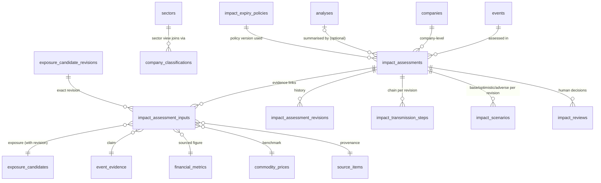
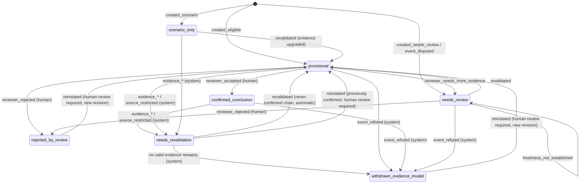

# Migration 0009 design: Phase 5 impact assessments

**Design only.**
- No SQL file is written. Migrations 0001–0008 are not modified.
- No database is altered. Production Turso is unchanged (0001–0005 applied; 0006–0008 not applied;
  verified read-only on 2026-11-07).
- Phase 5 is not started.

**Revision 2:** owner refinements on PR #20 (expiry policy, withdrawal codes, reinstatement, sector
views, foreign-key verification, cascade safety, delete scope, audit boundary).

Based on `main` @ `c864af1` and the merged Phase 5 contract:
- `PHASE_5_DATA_CONTRACT.md`
- `PHASE_5_TRANSMISSION_FRAMEWORK.md`
- `PHASE_5_TEST_STRATEGY.md`
- `PHASE_5_IMPLEMENTATION_ROADMAP.md`

## 1. Current schema assessment
| Existing object | Relevant to Phase 5 | Gap |
|---|---|---|
| `events`, `event_revisions` (0002) | event input; `verification_state` includes `refuted`, `disputed`; append-only revisions | no link to assessments |
| `event_evidence` (0002) | claim evidence | — |
| `exposure_candidates*`, `exposure_candidate_evidence`, `exposure_reviews`, `evidence_retractions` (0008) | exposure input and evidence | — |
| `exposure_candidates_current`, `invalid_candidate_evidence` views (0008) | read-time validity | assessments must reuse them |
| `analyses` (0003) | versioned per-(event, company) summary; `label` qualitative/quantitative; one `confidence` | **no delete protection**; one confidence; no per-mechanism key; no evidence links; no status |
| `financial_metrics`, `commodity_prices` (0003) | sourced quantification inputs | — |
| `alerts_predictions`, `market_outcomes` (0003) | frozen theses, observed outcomes (Phase 14) | must stay separate from assessments |
| `sectors`, `company_classifications` (0001) | sector aggregation | — |
| `sources.is_synthetic` (0008) | synthetic marker | — |

**Decision:**
- Keep `analyses` unchanged, and add only a delete-protection trigger to it.
- Add new tables for per-mechanism assessments. Old rows stay valid.

## 2. Proposed objects (all additive)

| Object | Kind | Purpose |
|---|---|---|
| `impact_assessments` | table | one row per (event × **company** × mechanism × scenario kind × transmission version); current state. **Company level only.** Sector results are views (§4b). |
| `impact_assessment_inputs` | table | normalised FK links to every input; append-only |
| `impact_assessment_revisions` | table | immutable audit of every state; trigger-written |
| `impact_transmission_steps` | table | ordered chain steps per revision |
| `impact_scenarios` | table | base/optimistic/adverse framing per revision |
| `impact_reviews` | table | human decisions; append-only |
| `impact_expiry_policies` | table | versioned expiry policies (§8b); **empty until the owner approves one** |
| `impact_sector_aggregates_current` | view | computed sector aggregation (§4b) |
| `impact_invalid_inputs` | view | inputs that are currently invalid |
| `impact_assessments_current` | view | read model with `effective_status` and `data_label` |
| `trg_analyses_no_delete` | trigger on existing `analyses` | closes the 0003 gap |
| refutation propagation trigger | trigger on existing `events` | §6 |

**Not needed as separate objects:**
- stored sector aggregates: these are a computed view initially; a materialised table can be added
  later in a separate migration, with the same input-link pattern;
- a revalidation-request table: requests are review decisions or audit revisions;
- a confidence table: confidence is five columns with reasons;
- a mechanism table: the T1–T9 library is versioned code, and only `mechanism_id` plus
  `transmission_version` are stored.

## 3. Column-level design
Conventions follow 0002 and 0008:
- `INTEGER PRIMARY KEY`; timestamps are `TEXT` UTC `YYYY-MM-DDTHH:MM:SSZ` (`*_at_utc`);
- JSON columns `CHECK (json_valid(...))`;
- enumerations as `CHECK (... IN (...))`;
- every free text is non-blank.

### `impact_assessments`
| Column | Type / null | Rule |
|---|---|---|
| `assessment_id` | INTEGER PK | |
| `event_id` | INTEGER NOT NULL FK `events` | |
| `event_revision_no` | INTEGER NOT NULL | composite FK (`event_id`, `event_revision_no`) → `event_revisions(event_id, revision_no)` |
| `company_id` | TEXT NOT NULL FK `companies(company_id)` | company level only |
| `mechanism_id` | TEXT NOT NULL | `GLOB 'T[1-9]'` (T1–T9) |
| `transmission_version` | TEXT NOT NULL | e.g. `transmission/1.0.0` |
| `ruleset_version` | TEXT NOT NULL | Phase 4 exposure rules used |
| `calculation_version` | TEXT NULL | only when quantified |
| `scenario_kind` | TEXT NOT NULL | `current` · `hypothetical` · `historical_test` |
| `assessment_status` | TEXT NOT NULL | §5 |
| `status_reason` | TEXT NOT NULL | §5 reason codes |
| `direction` | TEXT NOT NULL | `positive` · `negative` · `mixed` · `neutral` · `unknown` |
| `magnitude_level` | TEXT NOT NULL | `low` · `medium` · `high` · `not_assessable` |
| `magnitude_basis` | TEXT NOT NULL | `qualitative` · `deterministic_model` · `financially_quantified` |
| `horizon` | TEXT NOT NULL | `short` · `medium` · `long` · `unknown` |
| `evidence_confidence`, `exposure_confidence`, `direction_confidence`, `magnitude_confidence` | TEXT NOT NULL | `low` · `medium` · `high` |
| `scenario_uncertainty` | TEXT NOT NULL | `narrow` · `wide` · `undetermined` |
| `confidence_reasons_json` | TEXT NOT NULL | one reason per dimension |
| `affected_lines_json`, `counter_evidence_json`, `missing_inputs_json` | TEXT NOT NULL | JSON arrays |
| `quantification_json` | TEXT NULL | formula id, inputs, unit, result, sensitivity; NOT NULL iff basis = `financially_quantified` |
| `market_check` | TEXT NOT NULL | `CHECK (market_check = 'not_evaluable')` in 0009 |
| `analysis_id` | INTEGER NULL FK `analyses(analysis_id)` | optional summary link |
| `expiry_policy_version` | TEXT NULL FK `impact_expiry_policies(policy_version)` | NULL = no approved policy existed at assessment time (recorded, never assumed) |
| `freshness_basis` | TEXT NOT NULL | `explicit_source_expiry` · `policy_expiry` · `not_established` (§8b) |
| `is_synthetic` | INTEGER NOT NULL | 0/1 |
| `current_revision` | INTEGER NOT NULL ≥ 1 | |
| `last_review_id` | INTEGER NULL FK `impact_reviews` | |
| `change_reason`, `changed_by`, `actor_type` | TEXT NOT NULL | `actor_type` ∈ `human` · `system` |
| `created_at_utc`, `updated_at_utc` | TEXT NOT NULL | |

**Deliberately absent:** numeric impact scores, percentages, thresholds, price targets and
observed-reaction columns.

### `impact_assessment_inputs` (append-only)
| Column | Rule |
|---|---|
| `assessment_id` FK | |
| `input_kind` | `exposure_candidate` · `event_evidence` · `financial_metric` · `commodity_price` |
| `exposure_candidate_id` + `exposure_candidate_revision` | composite FK → `exposure_candidate_revisions(candidate_id, revision_no)` (0008 PK); the exact revision used |
| `event_evidence_id` | FK → `event_evidence(evidence_id)` (0002) |
| `financial_metric_id` | FK → `financial_metrics(metric_id)` (0003) |
| `commodity_price_id` | FK → `commodity_prices(price_id)` (0003) |
| (exactly one target) | CHECK: exactly one of the four targets per row, matching `input_kind` |
| `source_item_id` | NOT NULL FK → `source_items(source_item_id)` (0001); must equal the target's own `source_item_id` (trigger) |
| `step_no` | NULL or chain step it supports |
| `added_at_utc` | |

Validation triggers (Phase 4 pattern):
- The input must belong to the same event (evidence) or company (exposure, financial metric).
- The candidate revision must exist.
- A synthetic input can't be linked to a non-synthetic assessment.
- No links can be added to a terminal assessment.

### `impact_assessment_revisions` (append-only; written only by triggers)
- **Columns:** `assessment_id`, `revision_no` (PK pair), `recorded_at_utc`, `previous_status`,
  `new_status`, `status_reason`, `actor_type`, `actor`, `review_id` (NULL unless human),
  `snapshot_json` (full row), `input_snapshot_json` (input ids plus each one's validity at that moment).
- **Guards:** hand inserts are refused unless they are the current revision; no update or delete.

### `impact_transmission_steps`
- **Columns:** `assessment_id`, `revision_no`, `step_no` (PK); `from_variable`, `to_variable`, `sign`
  (`+1`, `-1`, `0`, NULL = unknown), `lag_horizon`, `explanation`.
- **Guards:** append-only. The assessment's direction must be `unknown` if any step sign is NULL. This
  is enforced by the engine, and checked by a trigger on status upgrade.

### `impact_scenarios`
- **Columns:** `assessment_id`, `revision_no`, `scenario_case` (`base`, `optimistic`, `adverse`) (PK);
  `direction`, `magnitude_level`, `assumptions_json`.
- **Guards:** append-only. These are qualitative scenarios, not forecasts; the editable simulator
  belongs to Phase 12.

### `impact_reviews` (append-only)
- **Columns:** `review_id` PK; `assessment_id` FK; `decision` (`accept`, `reject`,
  `request_revalidation`, `needs_more_evidence`); `reviewer` (≥ 2 characters); `notes` (non-blank);
  `decided_at_utc` (GLOB format); `status_at_decision`.
- **Guards:** `status_at_decision` must equal the current status. `accept` is allowed only from
  `provisional` with all inputs valid.

### Indexes
- **Unique key:** UNIQUE (event_id, company_id, mechanism_id, scenario_kind, transmission_version).
  All columns are NOT NULL, so no expression index is needed.
- **Lookups:** `ix_impact_company`, `ix_impact_status`, `ix_impact_inputs_candidate`,
  `ix_impact_inputs_assessment`, `ix_impact_reviews_assessment`.

### Foreign-key verification against migrations 0001–0008 (checked on `main` @ `c864af1`)
| Proposed reference | Target | Defined in | Exists |
|---|---|---|---|
| `event_id` | `events(event_id)` INTEGER PK | 0002 | yes |
| (`event_id`, `event_revision_no`) | `event_revisions(event_id, revision_no)` composite PK | 0002 | yes |
| `company_id` | `companies(company_id)` TEXT PK | 0001 | yes |
| `analysis_id` | `analyses(analysis_id)` INTEGER PK | 0003 | yes |
| `exposure_candidate_id` | `exposure_candidates(candidate_id)` INTEGER PK | 0008 | yes |
| (`exposure_candidate_id`, `exposure_candidate_revision`) | `exposure_candidate_revisions(candidate_id, revision_no)` composite PK | 0008 | yes |
| `event_evidence_id` | `event_evidence(evidence_id)` INTEGER PK | 0002 | yes |
| `financial_metric_id` | `financial_metrics(metric_id)` INTEGER PK | 0003 | yes |
| `commodity_price_id` | `commodity_prices(price_id)` INTEGER PK | 0003 | yes |
| `source_item_id` | `source_items(source_item_id)` INTEGER PK | 0001 | yes |
| sector join (views) | `company_classifications(company_id, sector_id, valid_to)`, `sectors(sector_id)` | 0001 | yes |
| ~~`component_assessment_id`~~ | — | — | **removed**: sector aggregation is a view, so no self-reference is needed |

**Future dependencies (not created by 0009):** none required. `financial_metrics` and
`commodity_prices` exist but hold no rows until approved sources exist; this is a data dependency, not
a schema one.

## 4. Constraints summary
| Constraint | Enforced by |
|---|---|
| Withdrawal reason codes | `assessment_status = 'withdrawn_evidence_invalid'` ⇔ `status_reason IN ('event_refuted','evidence_revoked','evidence_superseded','evidence_expired','evidence_retracted','source_restricted','exposure_rejected')` AND `actor_type = 'system'` (CHECK) |
| Human rejection | `assessment_status = 'rejected_by_review'` ⇔ `status_reason = 'reviewer_rejected'` AND `actor_type = 'human'` AND `last_review_id` refers to a `reject` review of this assessment (CHECK + trigger) |
| `evidence_expired` | allowed only when `freshness_basis ∈ {explicit_source_expiry, policy_expiry}`, and for `policy_expiry` only with a non-NULL approved `expiry_policy_version` (trigger) |
| `confirmed_conclusion` ⇔ accepted review referenced by `last_review_id` | CHECK + update trigger |
| Reinstatement of a previously `confirmed_conclusion` chain | requires an `accept` review dated after the withdrawal or rejection (trigger) |
| Insert only as `scenario_only`, `provisional` (with eligible inputs) or `needs_review`; never `confirmed_conclusion` | insert trigger |
| Refuted event ⇒ `scenario_kind ∈ {hypothetical, historical_test}` | insert trigger |
| Rumour stage or disputed event ⇒ status ≤ `provisional`; direction ∈ {mixed, unknown} when disputed | insert/update trigger |
| Upgrade to `provisional`/`confirmed_conclusion` ⇒ no rows in `impact_invalid_inputs`; exposure inputs' `effective_status` eligible per contract §3 | update trigger |
| `financially_quantified` ⇒ quantification JSON and sourced inputs present | CHECK + trigger |
| `market_check = 'not_evaluable'` | CHECK |
| No delete on any new table, nor on `analyses` | triggers |

## 4b. Sector aggregation (computed view)
`impact_sector_aggregates_current` is computed from `impact_assessments_current` joined to the
current `company_classifications`. Nothing is stored and nothing duplicated.

| Output column | Rule |
|---|---|
| `sector_id`, `event_id`, `mechanism_id`, `scenario_kind` | grouping keys |
| `company_count`, `positive_n`, `negative_n`, `mixed_n`, `neutral_n`, `unknown_n` | counts of company assessments by effective direction |
| `sector_direction` | `positive` / `negative` only if **every** included company is that sign with valid inputs; `neutral` if all neutral; `unknown` if any company is unknown and the rest agree; otherwise `mixed`. Unknowns are never converted into a sign. |
| `component_assessment_ids` | JSON list of the company assessments used (traceability) |
| `excluded_company_ids` | companies in the sector **without** a company assessment. Sector membership never creates exposure. |
| `is_synthetic` | MAX over components. `data_label = 'SYNTHETIC TEST DATA'` if any component is synthetic |
| `effective_status_floor` | the weakest effective status among components |

The view stores no assumptions. Each company's evidence and assumptions stay on its own assessment.
A materialised aggregate can be added later (a separate migration) with explicit input links, if
performance requires it.

## 5. Lifecycle, statuses and reason codes
**Naming convention:** snake_case, following the Phase 4 `evidence_status` style. The terminal
outcomes carry their cause in the status itself, so they can never be conflated:

| Status | Meaning | Actor |
|---|---|---|
| `scenario_only` | labelled scenario (potential or unverified exposure, rumour, hypothetical) | system |
| `provisional` | eligible evidence, awaiting review | system |
| `needs_review` | contradiction, disputed event, or missing evidence | system |
| `needs_revalidation` | an input became invalid; may be restored by revalidation | system or reviewer |
| `confirmed_conclusion` | accepted by a human; inputs valid; event corroborated or primary-confirmed | human |
| `withdrawn_evidence_invalid` | **evidence-driven** withdrawal (terminal for this revision chain) | system |
| `rejected_by_review` | **human** rejection (terminal) | human |

| Reason code | Allowed with status |
|---|---|
| `created_eligible`, `created_scenario`, `created_needs_review` | initial states |
| `event_refuted` | `withdrawn_evidence_invalid` |
| `evidence_revoked`, `evidence_superseded`, `evidence_expired`, `evidence_retracted`, `source_restricted`, `exposure_rejected` | `needs_revalidation`, or `withdrawn_evidence_invalid` when no valid replacement exists |
| `event_disputed` | `needs_review` |
| `reviewer_accepted` | `confirmed_conclusion` |
| `reviewer_rejected` | `rejected_by_review` only |
| `reviewer_requested_revalidation`, `reviewer_needs_more_evidence` | `needs_revalidation`, `needs_review` |
| `revalidated` | back to `provisional` or `scenario_only` (new revision, automatic) when all inputs are valid again and the chain was **never** confirmed |
| `reinstated` | back to `provisional` (new revision) for a chain that was previously `confirmed_conclusion` and then withdrawn or rejected. **Requires a human `accept` review**; it does not restore `confirmed_conclusion` directly. A second acceptance is needed to confirm again. |
| `freshness_not_established` | `needs_review`, when no approved expiry policy or explicit source expiry can establish freshness |
| `rule_version_superseded` | new assessment under a new `transmission_version`; the old one is kept |

## 6. Event refutation and human rejection: separate workflows
**A. Evidence-driven withdrawal (system).**
- **Trigger:** an event revision sets `verification_state = 'refuted'`. A new `AFTER UPDATE OF
  verification_state ON events` trigger (additive) moves every non-terminal `current` assessment for
  that event to `withdrawn_evidence_invalid`, reason `event_refuted`, actor `system:event_refutation`.
  Each one gets a new revision. The revision row records the previous status, the event revision number
  and the input snapshot.
- **Evidence revocation, supersession, expiry, retraction or source restriction:** handled by the
  engine's revalidation (next point) or detected at read time. These move assessments to
  `needs_revalidation`, or to `withdrawn_evidence_invalid` when no valid input remains. Reasons are the
  specific `evidence_*` or `source_restricted` codes.

**B. Human rejection.**
- An `impact_reviews` row with `decision = 'reject'`, a reviewer and notes. The update to
  `rejected_by_review` requires `last_review_id` to point to it and reason `reviewer_rejected`.
- The system can never produce `rejected_by_review`, and a human review can never produce
  `withdrawn_evidence_invalid`. Both are guarded by the status↔reason↔actor constraints.

**Reinstatement:**
- If a refutation is later reversed (a new event revision), or a rejection is reconsidered,
  assessments are **not** silently revived.
- A new revision with reason `reinstated` is required, and a human `accept` review is required for
  any chain that was ever withdrawn or rejected after being confirmed.
- Prior revisions are never rewritten.

| Transition | Automatic (system) | Human review required |
|---|---|---|
| create (scenario, provisional, needs_review) | yes | — |
| any → `needs_revalidation` (input invalid) | yes | — |
| any non-terminal → `withdrawn_evidence_invalid` | yes | — |
| `needs_revalidation` → `provisional` (never confirmed) | yes (`revalidated`) | — |
| `provisional` → `confirmed_conclusion` | — | yes (`accept`) |
| → `rejected_by_review` | — | yes (`reject`) |
| `withdrawn` / `rejected` / previously confirmed → `provisional` | — | yes (`reinstated` plus `accept`) |
| `needs_review` (freshness not established) → `provisional` | — | yes |

## 6b. Cascade execution sequence (prototype-tested)
For an event update that sets `verification_state = 'refuted'`, everything happens inside **one
statement transaction**:
1. `UPDATE events …` (through the Phase 1 repository: a new event revision row is inserted first,
   then the event is updated in one batch).
2. `AFTER UPDATE OF verification_state ON events` fires when NEW is `refuted` and OLD is not. It
   selects that event's assessments with `scenario_kind = 'current'` that are not in a terminal status.
3. The trigger runs `UPDATE impact_assessments SET assessment_status = 'withdrawn_evidence_invalid',
   status_reason = 'event_refuted', actor_type = 'system', changed_by = 'system:event_refutation',
   current_revision = current_revision + 1 …`. The BEFORE UPDATE guards check the status↔reason↔actor
   rules.
4. The nested `AFTER UPDATE ON impact_assessments` trigger inserts the immutable revision row
   (previous and new status, reason, actor, snapshot, input snapshot).
5. Input validity changes nothing in storage. `impact_invalid_inputs` and `impact_assessments_current`
   are views, so the next read reflects the new state.
6. **Failure:** if any step raises (a guard, a duplicate revision key, a constraint), SQLite aborts the
   whole statement. The event update, every assessment update and every revision insert roll back
   together. With the runner's batch transaction, the whole batch rolls back.

**Recursion:** `PRAGMA recursive_triggers` is OFF by default (confirmed below). Nested triggers on
*other* tables still fire; this is what the design relies on. The assessment trigger does not update
`events`, so there is no loop.

**Ordering:** the design never relies on the order of several triggers on the same event. Each table
has exactly one AFTER trigger that writes.

**Prototype test, 2026-11-08.** Scratch script, not a migration; it lives in a throwaway scratchpad
outside the repository. The steps tested:
- the event-refutation trigger, the nested revision trigger and the status↔reason CHECK;
- that terminal rows (`rejected_by_review`) and non-current scenarios are left alone;
- a forced audit-insert failure (duplicate revision key).

| Engine | Cascade correct | Audit failure rolls back the event update | `recursive_triggers` default |
|---|---|---|---|
| SQLite 3.53.1 (stdlib) | yes | yes | 0 (off) |
| SQLite 3.47.0 (`sqlean.py`, Turso's reported version) | yes | yes | 0 (off) |
| libSQL embedded engine (3.45.1 base) | yes | yes | 0 (off) |

**Not verified on a Turso server,** nor through the Hrana HTTP pipeline. The real 0009 must be tested on
a disposable Turso database (gate 3).

## 7. Immutable audit
- Every insert and update writes a revision row by trigger, with previous and new status, reason,
  actor type, actor, review id, a full snapshot and an input-validity snapshot.
- Revisions, inputs, steps, scenarios and reviews are append-only. Assessments can't be deleted.
- Timestamps are recorded in UTC. The actor is recorded as `human:<reviewer>` or
  `system:<process>`.

## 8. Evidence validity and revalidation
- **`impact_invalid_inputs` (view)** lists an input as invalid when:
  - its exposure candidate is no longer `evidence_currently_valid`, or its `effective_status` falls
    below the eligibility required for the assessment's status (from `exposure_candidates_current`);
  - its event evidence or company exposure is retracted (`evidence_retractions`);
  - its source is no longer ACTIVE, approved, verified and enabled;
  - its exposure candidate revision is older than the candidate's current revision **and** the newer
    revision changed status, direction or evidence (stale);
  - a component assessment is invalid (sector aggregation).
- **`impact_assessments_current` (view)** returns `effective_status = needs_revalidation` whenever the
  stored status is non-terminal and any input is invalid. It also returns
  `data_label = 'SYNTHETIC TEST DATA'` or `'real'`. **Consumers read only this view.**
- **Write-time re-check:** the upgrade triggers refuse `provisional` and `confirmed_conclusion` while
  any input is invalid.
- **Scheduled revalidation is not assumed.** The engine calls revalidation before every Phase 5 run,
  and the read view is the guarantee in between.
- **Expiry** uses the contract §3 freshness rule, implemented in the engine with a versioned freshness
  policy. The view can't evaluate "now" reliably across engines, which is an open question (§16).

## 8b. Versioned expiry policy (mechanism only; no durations chosen)
- **`impact_expiry_policies`:**
  - columns: `policy_version` TEXT PK; `effective_from_utc` NOT NULL; `approved_by` NOT NULL;
    `approved_at_utc` NOT NULL; `rules_json` NOT NULL (per exposure kind or input kind: a duration, or
    `none`); `status` (`draft` · `approved` · `retired`);
  - append-only: a new version supersedes, never edits.
- **Shipped empty.** 0009 inserts **no** policy rows. With no approved policy:
  - **no policy-derived expiry ever happens**, so evidence is never silently expired;
  - only **explicit source expiry** can expire an input. That means a dated validity in the evidence
    itself: `valid_to` on `company_exposures`, `company_relationships`, `company_identifiers` or
    `company_aliases`, or the source's own stated validity.
- **Freshness basis per assessment:**

  | `freshness_basis` | When |
  |---|---|
  | `explicit_source_expiry` | the input carries its own validity end date |
  | `policy_expiry` | an approved policy is in effect at assessment time; `expiry_policy_version` recorded |
  | `not_established` | neither applies; the assessment can be at most `needs_review` (reason `freshness_not_established`), never `confirmed_conclusion` |

- **Recorded per assessment:** the policy version in effect (or NULL) is stored on every assessment and
  copied into every revision snapshot. A later policy never rewrites earlier assessments; it triggers
  a revalidation pass that writes new revisions.
- **`evidence_expired`:** this reason requires an explicit source expiry or an approved policy version
  (§4 constraint).

## 9. Synthetic-data isolation
- `is_synthetic` on assessments. An input trigger refuses linking a synthetic source item, a synthetic
  exposure candidate or a synthetic component to a non-synthetic assessment.
- A sector aggregate (view) is synthetic if any component is synthetic: `MAX(is_synthetic)` plus the
  label.
- A non-synthetic assessment can't reference a company whose id matches `cmp-syn-*`. Tests also assert
  the seed company master has no `SYN*` tickers or `cmp-syn-*` ids.
- Synthetic fixtures use `syn`-prefixed sources with `is_synthetic = 1`.
- `data_label` is shown in every read view. No synthetic data is ever written to production Turso.

## 9b. Delete protection scope (`analyses`) and retention
- **Scope:** `trg_analyses_no_delete` blocks `DELETE` on `analyses` only. `analyses` is already
  update-protected (0003), so it is an append-only versioned record, consistent with the rest of the
  audit tables.
- **Test cleanup:** not affected. Tests use throwaway in-memory or temporary databases that are
  discarded whole, never row-deleted (current practice).
- **Migrations:** not affected. Migrations only add objects, and `migrate.py` refuses destructive
  statements.
- **Retention-policy or legally required deletion** (for example a licence that requires deleting
  derived data on termination): not possible through ordinary SQL, by design. The authorised path is a
  separately reviewed migration or operator procedure that:
  1. is approved by the owner and recorded in the repository;
  2. writes a deletion record (what, why, approval reference, time) to an append-only log first;
  3. temporarily drops and re-creates the guard trigger inside the same transaction.

  This procedure is to be designed when the first retention obligation exists. It is not part of 0009.
- **Not weakened:** no other audit table gets a deletion path.

## 9c. Boundary of immutability
- **Enforced:** `BEFORE UPDATE` and `BEFORE DELETE` triggers raise on audit tables. The INSERT guard
  refuses forged revisions unless they are for the current revision. Insert-time CHECKs and triggers
  reject invalid states.
- **What this protects against:** application bugs, ordinary SQL mistakes and any client using the
  normal connection.
- **What it does not protect against:**
  - a database owner or operator with schema rights, who can `DROP TRIGGER`, alter tables, or restore
    or replace the database;
  - Turso account holders, who can delete or branch the database;
  - anyone with the raw file, for SQLite.

  **Triggers are integrity guards, not tamper-proof storage.**
- **Optional future hardening** (not in 0009): periodic hash-chained export of revision rows (each
  row's hash includes the previous hash) to an external append-only location; least-privilege tokens
  for the app versus schema operations; backups with retention. These need separate approval.

## 10. Turso compatibility
- **Features used:** triggers with `RAISE`, triggers on existing tables (`events`, `analyses`),
  views referenced from triggers, `json_valid`/`json_object`, composite foreign keys, and cascading
  trigger writes.
  - The first four were exercised by 0008 on SQLite 3.47.0 and the libSQL engine.
  - The cascade was prototype-tested on SQLite 3.53.1, 3.47.0 and libSQL 3.45.1 (§6b).
  - Composite FKs are standard SQLite, but are not yet exercised in this project.
- **Not verified on a Turso server.** 0006–0009 must be applied to a **disposable Turso database**
  first, through the project's Hrana pipeline (`database/migrate.py`, one transactional batch per
  file), with the full test suite run against it.
- **Foreign keys:** the connection enables `PRAGMA foreign_keys`. Verify on Turso that the FKs in new
  tables are enforced.

## 11. Application and rollback strategy
- **Additive only:** new tables, views, indexes and triggers. No existing column is altered or dropped
  (the migration runner refuses destructive statements).
- The file is applied atomically by the runner. A failure rolls back the whole file, and the
  checksum is recorded only on success.
- **No down-migration** (project convention). Rollback means not applying it. A defect after
  application is fixed by migration 0010, never by editing 0009.
- **Order:** 0009 depends on 0006–0008. Production would receive 0006–0009 together, only after
  disposable-Turso verification and owner approval.

## 12. Integrity risks
| Risk | Mitigation |
|---|---|
| Stale exposure revision supports a conclusion | capture the revision on the input; staleness rule in the view; write-time trigger |
| Status and reason inconsistent | status↔reason↔actor CHECK and triggers |
| Trigger cascade differs on Turso | disposable-Turso test before approval |
| Expiry not evaluated by the database | engine-enforced freshness policy plus tests; open question §16 |
| Duplicate assessments | UNIQUE key on NOT NULL columns, plus engine idempotency |
| Audit write fails during cascade | whole statement rolls back (prototype-verified on three engines) |
| Silent expiry | no policy shipped; `freshness_not_established` routes to review |
| Privileged tampering | documented boundary (§9c); hardening is a later decision |
| Old `analyses` rows deleted | new delete-protection trigger |

## 13. Security and provenance
- Every assessment links event revision, candidate revisions, evidence, source items and versions
  (`ruleset_version`, `transmission_version`, `calculation_version`, model and prompt if narrative is
  used).
- Reviewer identity is required. No secrets or credentials are stored.
- Free text is never interpolated into SQL; parameters only (existing pattern).

## 14. Test requirements (future implementation)
- All of S1–S21 from `PHASE_5_TEST_STRATEGY.md`.
- Additionally:
  - **Refutation versus rejection:** an event refutation creates `withdrawn_evidence_invalid` with
    reason `event_refuted` and actor system; a human reject creates `rejected_by_review` with a review
    row. Direct SQL cannot cross them (for example `rejected_by_review` without a review, or
    `withdrawn_evidence_invalid` with reason `reviewer_rejected`).
  - **Reinstatement** creates a new revision; old revisions are unchanged.
  - **Direct-SQL bypass** attempts for every constraint in §4.
  - **Cascade:** an event update to refuted writes revisions for every affected assessment, in one
    transaction. A forced audit-insert failure rolls back the event update. Terminal and non-current
    rows are untouched.
  - **Expiry:** with no approved policy, nothing expires by policy, and `not_established` routes to
    review. With an explicit `valid_to`, the input expires with `evidence_expired`. A test policy must
    be labelled `TEST PARAMETER`.
  - **Reinstatement:** it is refused without an `accept` review for previously confirmed chains.
  - **Sector view:** unknowns stay unknown; a single opposite sign gives `mixed`; companies without an
    assessment are listed as excluded, not counted.
  - **Composite FK:** the exposure candidate revision must exist.
  - **Synthetic isolation:** S19–S21, plus the `cmp-syn-*` guard.
  - **Compatibility:** SQLite 3.47.0 and libSQL engine runs, and later a disposable Turso run.

## 15. Explicit exclusions
- No SQL, no change to 0001–0008, no table creation or alteration, and no production change.
- No source activation, collectors, dependencies, workflows or secrets.
- No Phase 5 code.
- No numeric thresholds or scores (2% and 10% are not reintroduced).
- No market-reaction data.

## 16. Decisions and remaining questions
**Decided (owner, PR #20 review):**
- expiry is a versioned policy mechanism with no defaults;
- a single `withdrawn_evidence_invalid` status with seven mandatory reason codes;
- `rejected_by_review` stays separate;
- human review before reinstating any previously confirmed chain;
- sector aggregates as computed views.

**Remaining:**
1. The content of the first expiry policy: durations per exposure kind. It needs owner approval and a
   calibration rationale.
2. The authorised retention-deletion procedure (§9b), when the first obligation arises.
3. Whether to add hash-chained audit export (§9c).
4. Composite-FK and cascade behaviour on a Turso server, through Hrana (gate 3).
5. **Gate 1:** owner approves this design.
6. **Gate 2:** the 0009 SQL is written and tested locally and in CI (synthetic).
7. **Gate 3:** disposable-Turso verification of 0006–0009.
8. **Gate 4:** owner approval for production.
