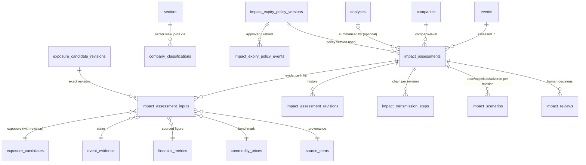
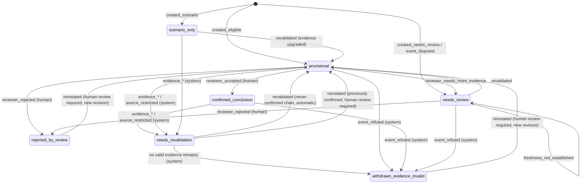

# Migration 0009 design: Phase 5 impact assessments

**Design only.**
- No SQL file is written. Migrations 0001–0008 are not modified.
- No database is altered. Production Turso is unchanged (0001–0005 applied; 0006–0008 not applied;
  verified read-only on 2026-11-07).
- Phase 5 is not started.

**Revision 2:** owner refinements on PR #20 (expiry policy, withdrawal codes, reinstatement, sector
views, foreign-key verification, cascade safety, delete scope, audit boundary).

Based on `main` @ `c864af1` and the merged Phase 5 contract:
- `PHASE_5_DATA_CONTRACT.md`
- `PHASE_5_TRANSMISSION_FRAMEWORK.md`
- `PHASE_5_TEST_STRATEGY.md`
- `PHASE_5_IMPLEMENTATION_ROADMAP.md`

## 1. Current schema assessment
| Existing object | Relevant to Phase 5 | Gap |
|---|---|---|
| `events`, `event_revisions` (0002) | event input; `verification_state` includes `refuted`, `disputed`; append-only revisions | no link to assessments |
| `event_evidence` (0002) | claim evidence | — |
| `exposure_candidates*`, `exposure_candidate_evidence`, `exposure_reviews`, `evidence_retractions` (0008) | exposure input and evidence | — |
| `exposure_candidates_current`, `invalid_candidate_evidence` views (0008) | read-time validity | assessments must reuse them |
| `analyses` (0003) | versioned per-(event, company) summary; `label` qualitative/quantitative; one `confidence` | **no delete protection**; one confidence; no per-mechanism key; no evidence links; no status |
| `financial_metrics`, `commodity_prices` (0003) | sourced quantification inputs | — |
| `alerts_predictions`, `market_outcomes` (0003) | frozen theses, observed outcomes (Phase 14) | must stay separate from assessments |
| `sectors`, `company_classifications` (0001) | sector aggregation | — |
| `sources.is_synthetic` (0008) | synthetic marker | — |

**Decision:**
- Keep `analyses` unchanged, and add only a delete-protection trigger to it.
- Add new tables for per-mechanism assessments. Old rows stay valid.

## 2. Proposed objects (all additive)

| Object | Kind | Purpose |
|---|---|---|
| `impact_assessments` | table | one row per (event × **company** × mechanism × scenario kind × transmission version); current state. **Company level only.** Sector results are views (§4b). |
| `impact_assessment_inputs` | table | normalised FK links to every input; append-only |
| `impact_assessment_revisions` | table | immutable audit of every state; trigger-written |
| `impact_transmission_steps` | table | ordered chain steps per revision |
| `impact_scenarios` | table | base/optimistic/adverse framing per revision |
| `impact_reviews` | table | human decisions; append-only |
| `impact_expiry_policy_versions`, `impact_expiry_policy_events` | tables | immutable policy content and immutable lifecycle events (§8b); **empty** |
| `impact_expiry_policies_current` | view | derived policy status (§8b) |
| `impact_sector_aggregates_current` | view | computed sector aggregation (§4b) |
| `impact_invalid_inputs` | view | inputs that are currently invalid |
| `impact_assessments_current` | view | read model with `effective_status` and `data_label` |
| `trg_analyses_no_delete` | trigger on existing `analyses` | closes the 0003 gap |
| refutation propagation trigger | trigger on existing `events` | §6 |

**Not needed as separate objects:**
- stored sector aggregates: these are a computed view initially; a materialised table can be added
  later in a separate migration, with the same input-link pattern;
- a revalidation-request table: requests are review decisions or audit revisions;
- a confidence table: confidence is five columns with reasons;
- a mechanism table: the T1–T9 library is versioned code, and only `mechanism_id` plus
  `transmission_version` are stored.

## 3. Column-level design
Conventions follow 0002 and 0008:
- `INTEGER PRIMARY KEY`; timestamps are `TEXT` UTC `YYYY-MM-DDTHH:MM:SSZ` (`*_at_utc`);
- JSON columns `CHECK (json_valid(...))`;
- enumerations as `CHECK (... IN (...))`;
- every free text is non-blank.

### `impact_assessments`
| Column | Type / null | Rule |
|---|---|---|
| `assessment_id` | INTEGER PK | |
| `event_id` | INTEGER NOT NULL FK `events` | |
| `event_revision_no` | INTEGER NOT NULL | composite FK (`event_id`, `event_revision_no`) → `event_revisions(event_id, revision_no)` |
| `company_id` | TEXT NOT NULL FK `companies(company_id)` | company level only |
| `mechanism_id` | TEXT NOT NULL | `GLOB 'T[1-9]'` (T1–T9) |
| `transmission_version` | TEXT NOT NULL | e.g. `transmission/1.0.0` |
| `ruleset_version` | TEXT NOT NULL | Phase 4 exposure rules used |
| `calculation_version` | TEXT NULL | only when quantified |
| `scenario_kind` | TEXT NOT NULL | `current` · `hypothetical` · `historical_test` |
| `assessment_status` | TEXT NOT NULL | §5 |
| `status_reason` | TEXT NOT NULL | §5 reason codes |
| `direction` | TEXT NOT NULL | `positive` · `negative` · `mixed` · `neutral` · `unknown` |
| `magnitude_level` | TEXT NOT NULL | `low` · `medium` · `high` · `not_assessable` |
| `magnitude_basis` | TEXT NOT NULL | `qualitative` · `deterministic_model` · `financially_quantified` |
| `horizon` | TEXT NOT NULL | `short` · `medium` · `long` · `unknown` |
| `evidence_confidence`, `exposure_confidence`, `direction_confidence`, `magnitude_confidence` | TEXT NOT NULL | `low` · `medium` · `high` |
| `scenario_uncertainty` | TEXT NOT NULL | `narrow` · `wide` · `undetermined` |
| `confidence_reasons_json` | TEXT NOT NULL | one reason per dimension |
| `affected_lines_json`, `counter_evidence_json`, `missing_inputs_json` | TEXT NOT NULL | JSON arrays |
| `quantification_json` | TEXT NULL | formula id, inputs, unit, result, sensitivity; NOT NULL iff basis = `financially_quantified` |
| `market_check` | TEXT NOT NULL | `CHECK (market_check = 'not_evaluable')` in 0009 |
| `analysis_id` | INTEGER NULL FK `analyses(analysis_id)` | optional summary link |
| `expiry_policy_version` | TEXT NULL FK `impact_expiry_policy_versions(policy_version)` | NULL = no approved policy existed at assessment time (recorded, never assumed) |
| `freshness_basis` | TEXT NOT NULL | `explicit_source_expiry` · `policy_expiry` · `not_established` (§8b) |
| `is_synthetic` | INTEGER NOT NULL | 0/1 |
| `current_revision` | INTEGER NOT NULL ≥ 1 | |
| `last_review_id` | INTEGER NULL FK `impact_reviews` | |
| `change_reason`, `changed_by`, `actor_type` | TEXT NOT NULL | `actor_type` ∈ `human` · `system` |
| `created_at_utc`, `updated_at_utc` | TEXT NOT NULL | |

**Deliberately absent:** numeric impact scores, percentages, thresholds, price targets and
observed-reaction columns.

### `impact_assessment_inputs` (append-only)
| Column | Rule |
|---|---|
| `assessment_id` FK | |
| `input_kind` | `exposure_candidate` · `event_evidence` · `financial_metric` · `commodity_price` |
| `exposure_candidate_id` + `exposure_candidate_revision` | composite FK → `exposure_candidate_revisions(candidate_id, revision_no)` (0008 PK); the exact revision used |
| `event_evidence_id` | FK → `event_evidence(evidence_id)` (0002) |
| `financial_metric_id` | FK → `financial_metrics(metric_id)` (0003) |
| `commodity_price_id` | FK → `commodity_prices(price_id)` (0003) |
| (exactly one target) | CHECK: exactly one of the four targets per row, matching `input_kind` |
| `source_item_id` | NOT NULL FK → `source_items(source_item_id)` (0001); must equal the target's own `source_item_id` (trigger) |
| `step_no` | NULL or chain step it supports |
| `added_at_utc` | |

Validation triggers (Phase 4 pattern):
- The input must belong to the same event (evidence) or company (exposure, financial metric).
- The candidate revision must exist.
- A synthetic input can't be linked to a non-synthetic assessment.
- No links can be added to a terminal assessment.

### `impact_assessment_revisions` (append-only; written only by triggers)
- **Columns:** `assessment_id`, `revision_no` (PK pair), `recorded_at_utc`, `previous_status`,
  `new_status`, `status_reason`, `actor_type`, `actor`, `review_id` (NULL unless human),
  `snapshot_json` (full row), `input_snapshot_json` (input ids plus each one's validity at that moment).
- **Guards:** hand inserts are refused unless they are the current revision; no update or delete.

### `impact_transmission_steps`
- **Columns:** `assessment_id`, `revision_no`, `step_no` (PK); `from_variable`, `to_variable`, `sign`
  (`+1`, `-1`, `0`, NULL = unknown), `lag_horizon`, `explanation`.
- **Guards:** append-only. The assessment's direction must be `unknown` if any step sign is NULL. This
  is enforced by the engine, and checked by a trigger on status upgrade.

### `impact_scenarios`
- **Columns:** `assessment_id`, `revision_no`, `scenario_case` (`base`, `optimistic`, `adverse`) (PK);
  `direction`, `magnitude_level`, `assumptions_json`.
- **Guards:** append-only. These are qualitative scenarios, not forecasts; the editable simulator
  belongs to Phase 12.

### `impact_reviews` (append-only)
- **Columns:** `review_id` PK; `assessment_id` FK; `decision` (`accept`, `reject`,
  `request_revalidation`, `needs_more_evidence`); `reviewer` (≥ 2 characters); `notes` (non-blank);
  `decided_at_utc` (GLOB format); `status_at_decision`.
- **Guards:** `status_at_decision` must equal the current status. `accept` is allowed only from
  `provisional` with all inputs valid.

### Indexes
- **Unique key:** UNIQUE (event_id, company_id, mechanism_id, scenario_kind, transmission_version).
  All columns are NOT NULL, so no expression index is needed.
- **Lookups:** `ix_impact_company`, `ix_impact_status`, `ix_impact_inputs_candidate`,
  `ix_impact_inputs_assessment`, `ix_impact_reviews_assessment`.

### Foreign-key verification against migrations 0001–0008 (checked on `main` @ `c864af1`)
| Proposed reference | Target | Defined in | Exists |
|---|---|---|---|
| `event_id` | `events(event_id)` INTEGER PK | 0002 | yes |
| (`event_id`, `event_revision_no`) | `event_revisions(event_id, revision_no)` composite PK | 0002 | yes |
| `company_id` | `companies(company_id)` TEXT PK | 0001 | yes |
| `analysis_id` | `analyses(analysis_id)` INTEGER PK | 0003 | yes |
| `exposure_candidate_id` | `exposure_candidates(candidate_id)` INTEGER PK | 0008 | yes |
| (`exposure_candidate_id`, `exposure_candidate_revision`) | `exposure_candidate_revisions(candidate_id, revision_no)` composite PK | 0008 | yes |
| `event_evidence_id` | `event_evidence(evidence_id)` INTEGER PK | 0002 | yes |
| `financial_metric_id` | `financial_metrics(metric_id)` INTEGER PK | 0003 | yes |
| `commodity_price_id` | `commodity_prices(price_id)` INTEGER PK | 0003 | yes |
| `source_item_id` | `source_items(source_item_id)` INTEGER PK | 0001 | yes |
| sector join (views) | `company_classifications(company_id, sector_id, valid_to)`, `sectors(sector_id)` | 0001 | yes |
| ~~`component_assessment_id`~~ | — | — | **removed**: sector aggregation is a view, so no self-reference is needed |

**Future dependencies (not created by 0009):** none required. `financial_metrics` and
`commodity_prices` exist but hold no rows until approved sources exist; this is a data dependency, not
a schema one.

## 4. Constraints summary
| Constraint | Enforced by |
|---|---|
| Withdrawal reason codes | `assessment_status = 'withdrawn_evidence_invalid'` ⇔ `status_reason IN ('event_refuted','evidence_revoked','evidence_superseded','evidence_expired','evidence_retracted','source_restricted','exposure_rejected')` AND `actor_type = 'system'` (CHECK) |
| Human rejection | `assessment_status = 'rejected_by_review'` ⇔ `status_reason = 'reviewer_rejected'` AND `actor_type = 'human'` AND `last_review_id` refers to a `reject` review of this assessment (CHECK + trigger) |
| `evidence_expired` | allowed only when `freshness_basis ∈ {explicit_source_expiry, policy_expiry}`, and for `policy_expiry` only with a non-NULL approved `expiry_policy_version` (trigger) |
| `confirmed_conclusion` ⇔ accepted review referenced by `last_review_id` | CHECK + update trigger |
| Reinstatement of a previously `confirmed_conclusion` chain | requires an `accept` review dated after the withdrawal or rejection (trigger) |
| Insert only as `scenario_only`, `provisional` (with eligible inputs) or `needs_review`; never `confirmed_conclusion` | insert trigger |
| Refuted event ⇒ `scenario_kind ∈ {hypothetical, historical_test}` | insert trigger |
| Rumour stage or disputed event ⇒ status ≤ `provisional`; direction ∈ {mixed, unknown} when disputed | insert/update trigger |
| Upgrade to `provisional`/`confirmed_conclusion` ⇒ no rows in `impact_invalid_inputs`; exposure inputs' `effective_status` eligible per contract §3 | update trigger |
| `financially_quantified` ⇒ quantification JSON and sourced inputs present | CHECK + trigger |
| `market_check = 'not_evaluable'` | CHECK |
| No delete on any new table, nor on `analyses` | triggers |

## 4b. Sector aggregation (computed view, with coverage safeguards)
`impact_sector_aggregates_current` is computed from `impact_assessments_current`, the sector
classifications and the company master. **No aggregate rows are stored.** Each company's evidence and
assumptions stay on its own assessment. A materialised aggregate can be added later, in a separate
migration with explicit input links, if performance requires it.

### Eligible companies (grounded in the existing schema)
| Schema fact (0001) | Consequence |
|---|---|
| `company_classifications(company_id, sector_id, valid_from, valid_to)` with `ux_classification_current` UNIQUE on `company_id` WHERE `valid_to IS NULL` | A company has **at most one current** sector classification, and may have earlier, dated ones |
| `companies.listing_status` (`listed`, `delisted`, `suspended`, `unknown`) is the **current** status only | Point-in-time listing must come from `company_status_history` (append-only, `effective_date`) |

**Owner-decided definition:** the eligible set for (sector S, event E) is
the companies whose classification row for S is valid at E's `event_date`
(`valid_from IS NULL OR valid_from <= date`, and `valid_to IS NULL OR valid_to >= date`). When the event
has no `event_date`, the current classification is used, and this is flagged in
`eligibility_basis = 'current_classification'`.

| Case | Handling (owner decision, PR #20) |
|---|---|
| Classification | The classification valid on the event date. For undated events, the current classification, with `eligibility_basis = 'current_classification'` recorded. Classifications are never inferred or invented. |
| Delisted company | **Included** if it was listed on the event date, per `company_status_history` (historical status, not today's `listing_status`). Excluded with `not_listed_at_event_date` otherwise. |
| Suspended company | **Included** in the eligible population if it was listed on the event date and has a valid classification. Flagged `suspended_at_event_date`. Normal operations and ordinary exposure are **not** assumed. Its assessment is reported but **never contributes a sign** to `direction_among_assessed`, and its presence makes `completeness = 'partial'`. |
| Listing status `unknown` | Kept in coverage reporting where sector membership is established. Flagged `listing_status_unknown`. **Not** treated as proof of eligibility; the company is counted in `eligibility_uncertain_n`. Any such company makes `completeness = 'partial'`. |
| Unclassified company | Never assigned to a sector. Reported separately per event in `unclassified_companies` (count and list, reason `no_sector_classification`). |
| Several classifications over time | Resolved by event date. Two current classifications are impossible (unique index). |

### Output columns
| Column | Meaning |
|---|---|
| `sector_id`, `event_id`, `mechanism_id`, `scenario_kind` | grouping keys |
| `eligible_n` | companies eligible per the definition above |
| `assessed_valid_n` | eligible companies with a current assessment whose `effective_status` is valid (not `needs_revalidation`, `needs_review` or terminal). Suspended companies are counted separately (below). |
| `suspended_n`, `eligibility_uncertain_n` | suspended at the event date; listing status unknown |
| `assessed_review_n` | eligible companies whose assessment is `needs_review` or `needs_revalidation` |
| `assessed_terminal_n` | eligible companies whose assessment is withdrawn or rejected |
| `unassessed_n` | eligible companies with no assessment for this event and mechanism |
| `coverage_pct` | `assessed_valid_n / eligible_n` × 100 (NULL when `eligible_n = 0`); descriptive only, **no minimum threshold** |
| `completeness` | `complete` only when `eligible_n > 0`, `assessed_valid_n = eligible_n`, `suspended_n = 0` and `eligibility_uncertain_n = 0`; otherwise `partial` |
| `direction_among_assessed` | the rule below, applied **only to valid assessments of companies that are not suspended and not eligibility-uncertain** |
| `sector_conclusion` | equals `direction_among_assessed` only when `completeness = 'complete'`; otherwise `not_concluded_partial_coverage` |
| `positive_n`, `negative_n`, `mixed_n`, `neutral_n`, `unknown_n` | counts among valid assessments |
| `included_json` | `[{company_id, assessment_id, effective_status, direction}]` |
| `excluded_json` | `[{company_id, reason}]`; reasons: `no_assessment`, `assessment_needs_review`, `assessment_needs_revalidation`, `assessment_withdrawn`, `assessment_rejected`, `not_listed_at_event_date`, `suspended_at_event_date`, `listing_status_unknown` |
| `is_synthetic`, `data_label` | `MAX(is_synthetic)` over included **and** excluded assessments; `SYNTHETIC TEST DATA` if any is synthetic |
| `eligibility_basis` | `event_date_classification` or `current_classification` |

### Rules
1. `direction_among_assessed`:
   - `positive` or `negative` only if every valid assessment has that sign;
   - `neutral` if all are neutral;
   - `unknown` if any is unknown and the rest agree;
   - otherwise `mixed`.

   Unknowns are never turned into a sign, and disagreement stays `mixed`.
2. **A unanimous subset is not a sector conclusion.** With `partial` coverage the view reports
   `sector_conclusion = 'not_concluded_partial_coverage'`, and consumers must display it as a partial
   result.
3. Unassessed and invalid companies always appear in `excluded_json` and in the counts. They are never
   dropped.
4. Missing assessments are **never** fabricated or inferred from sector membership.
5. Synthetic and real data are distinguishable at row level. Tests also assert that a sector aggregate
   over real companies never includes a synthetic assessment, because the input trigger prevents
   mixing at company level.

## 5. Lifecycle, statuses and reason codes
**Naming convention:** snake_case, following the Phase 4 `evidence_status` style. The terminal
outcomes carry their cause in the status itself, so they can never be conflated:

| Status | Meaning | Actor |
|---|---|---|
| `scenario_only` | labelled scenario (potential or unverified exposure, rumour, hypothetical) | system |
| `provisional` | eligible evidence, awaiting review | system |
| `needs_review` | contradiction, disputed event, or missing evidence | system |
| `needs_revalidation` | an input became invalid; may be restored by revalidation | system or reviewer |
| `confirmed_conclusion` | accepted by a human; inputs valid; event corroborated or primary-confirmed | human |
| `withdrawn_evidence_invalid` | **evidence-driven** withdrawal (terminal for this revision chain) | system |
| `rejected_by_review` | **human** rejection (terminal) | human |

| Reason code | Allowed with status |
|---|---|
| `created_eligible`, `created_scenario`, `created_needs_review` | initial states |
| `event_refuted` | `withdrawn_evidence_invalid` |
| `evidence_revoked`, `evidence_superseded`, `evidence_expired`, `evidence_retracted`, `source_restricted`, `exposure_rejected` | `needs_revalidation`, or `withdrawn_evidence_invalid` when no valid replacement exists |
| `event_disputed` | `needs_review` |
| `reviewer_accepted` | `confirmed_conclusion` |
| `reviewer_rejected` | `rejected_by_review` only |
| `reviewer_requested_revalidation`, `reviewer_needs_more_evidence` | `needs_revalidation`, `needs_review` |
| `revalidated` | back to `provisional` or `scenario_only` (new revision, automatic) when all inputs are valid again and the chain was **never** confirmed |
| `reinstated` | back to `provisional` (new revision) for a chain that was previously `confirmed_conclusion` and then withdrawn or rejected. **Requires a human `accept` review**; it does not restore `confirmed_conclusion` directly. A second acceptance is needed to confirm again. |
| `freshness_not_established` | `needs_review`, when no approved expiry policy or explicit source expiry can establish freshness |
| `rule_version_superseded` | new assessment under a new `transmission_version`; the old one is kept |

## 6. Event refutation and human rejection: separate workflows
**A. Evidence-driven withdrawal (system).**
- **Trigger:** an event revision sets `verification_state = 'refuted'`. A new `AFTER UPDATE OF
  verification_state ON events` trigger (additive) moves every non-terminal `current` assessment for
  that event to `withdrawn_evidence_invalid`, reason `event_refuted`, actor `system:event_refutation`.
  Each one gets a new revision. The revision row records the previous status, the event revision number
  and the input snapshot.
- **Evidence revocation, supersession, expiry, retraction or source restriction:** handled by the
  engine's revalidation (next point) or detected at read time. These move assessments to
  `needs_revalidation`, or to `withdrawn_evidence_invalid` when no valid input remains. Reasons are the
  specific `evidence_*` or `source_restricted` codes.

**B. Human rejection.**
- An `impact_reviews` row with `decision = 'reject'`, a reviewer and notes. The update to
  `rejected_by_review` requires `last_review_id` to point to it and reason `reviewer_rejected`.
- The system can never produce `rejected_by_review`, and a human review can never produce
  `withdrawn_evidence_invalid`. Both are guarded by the status↔reason↔actor constraints.

**Reinstatement:**
- If a refutation is later reversed (a new event revision), or a rejection is reconsidered,
  assessments are **not** silently revived.
- A new revision with reason `reinstated` is required, and a human `accept` review is required for
  any chain that was ever withdrawn or rejected after being confirmed.
- Prior revisions are never rewritten.

| Transition | Automatic (system) | Human review required |
|---|---|---|
| create (scenario, provisional, needs_review) | yes | — |
| any → `needs_revalidation` (input invalid) | yes | — |
| any non-terminal → `withdrawn_evidence_invalid` | yes | — |
| `needs_revalidation` → `provisional` (never confirmed) | yes (`revalidated`) | — |
| `provisional` → `confirmed_conclusion` | — | yes (`accept`) |
| → `rejected_by_review` | — | yes (`reject`) |
| `withdrawn` / `rejected` / previously confirmed → `provisional` | — | yes (`reinstated` plus `accept`) |
| `needs_review` (freshness not established) → `provisional` | — | yes |

## 6b. Cascade execution sequence (prototype-tested)
For an event update that sets `verification_state = 'refuted'`, everything happens inside **one
statement transaction**:
1. `UPDATE events …` (through the Phase 1 repository: a new event revision row is inserted first,
   then the event is updated in one batch).
2. `AFTER UPDATE OF verification_state ON events` fires when NEW is `refuted` and OLD is not. It
   selects that event's assessments with `scenario_kind = 'current'` that are not in a terminal status.
3. The trigger runs `UPDATE impact_assessments SET assessment_status = 'withdrawn_evidence_invalid',
   status_reason = 'event_refuted', actor_type = 'system', changed_by = 'system:event_refutation',
   current_revision = current_revision + 1 …`. The BEFORE UPDATE guards check the status↔reason↔actor
   rules.
4. The nested `AFTER UPDATE ON impact_assessments` trigger inserts the immutable revision row
   (previous and new status, reason, actor, snapshot, input snapshot).
5. Input validity changes nothing in storage. `impact_invalid_inputs` and `impact_assessments_current`
   are views, so the next read reflects the new state.
6. **Failure:** if any step raises (a guard, a duplicate revision key, a constraint), SQLite aborts the
   whole statement. The event update, every assessment update and every revision insert roll back
   together. With the runner's batch transaction, the whole batch rolls back.

**Recursion:** `PRAGMA recursive_triggers` is OFF by default (confirmed below). Nested triggers on
*other* tables still fire; this is what the design relies on. The assessment trigger does not update
`events`, so there is no loop.

**Ordering:** the design never relies on the order of several triggers on the same event. Each table
has exactly one AFTER trigger that writes.

**Prototype test, 2026-11-08.** Scratch script, not a migration; it lives in a throwaway scratchpad
outside the repository. The steps tested:
- the event-refutation trigger, the nested revision trigger and the status↔reason CHECK;
- that terminal rows (`rejected_by_review`) and non-current scenarios are left alone;
- a forced audit-insert failure (duplicate revision key).

| Engine | Cascade correct | Audit failure rolls back the event update | `recursive_triggers` default |
|---|---|---|---|
| SQLite 3.53.1 (stdlib) | yes | yes | 0 (off) |
| SQLite 3.47.0 (`sqlean.py`, Turso's reported version) | yes | yes | 0 (off) |
| libSQL embedded engine (3.45.1 base) | yes | yes | 0 (off) |

**Not verified on a Turso server,** nor through the Hrana HTTP pipeline. The real 0009 must be tested on
a disposable Turso database (gate 3).

## 7. Immutable audit
- Every insert and update writes a revision row by trigger, with previous and new status, reason,
  actor type, actor, review id, a full snapshot and an input-validity snapshot.
- Revisions, inputs, steps, scenarios and reviews are append-only. Assessments can't be deleted.
- Timestamps are recorded in UTC. The actor is recorded as `human:<reviewer>` or
  `system:<process>`.

## 8. Evidence validity and revalidation
- **`impact_invalid_inputs` (view)** lists an input as invalid when:
  - its exposure candidate is no longer `evidence_currently_valid`, or its `effective_status` falls
    below the eligibility required for the assessment's status (from `exposure_candidates_current`);
  - its event evidence or company exposure is retracted (`evidence_retractions`);
  - its source is no longer ACTIVE, approved, verified and enabled;
  - its exposure candidate revision is older than the candidate's current revision **and** the newer
    revision changed status, direction or evidence (stale);
  - a component assessment is invalid (sector aggregation).
- **`impact_assessments_current` (view)** returns `effective_status = needs_revalidation` whenever the
  stored status is non-terminal and any input is invalid. It also returns
  `data_label = 'SYNTHETIC TEST DATA'` or `'real'`. **Consumers read only this view.**
- **Write-time re-check:** the upgrade triggers refuse `provisional` and `confirmed_conclusion` while
  any input is invalid.
- **Scheduled revalidation is not assumed.** The engine calls revalidation before every Phase 5 run,
  and the read view is the guarantee in between.
- **Expiry** uses the contract §3 freshness rule, implemented in the engine with a versioned freshness
  policy. The view can't evaluate "now" reliably across engines, which is an open question (§16).

## 8b. Versioned expiry policy (mechanism only; no durations; nothing approved)
The lifecycle is made immutable by separating **policy content** from **lifecycle events**. Neither is
ever updated or deleted.

**`impact_expiry_policy_versions`** (immutable content):

| Column | Rule |
|---|---|
| `policy_version` | TEXT PK (for example `expiry/1`) |
| `rules_json` | NOT NULL; per exposure or input kind: a duration, or `none` (`json_valid`) |
| `rationale` | NOT NULL; the calibration rationale |
| `drafted_by`, `drafted_at_utc` | NOT NULL |
| `supersedes_version` | NULL or FK to the previous version |

Guards: no UPDATE, no DELETE. Changing the content means a new version.

**`impact_expiry_policy_events`** (immutable lifecycle):

| Column | Rule |
|---|---|
| `policy_event_id` | INTEGER PK |
| `policy_version` | FK |
| `event_type` | `approved` · `retired` |
| `actor` | NOT NULL; the human approver or retirer |
| `effective_from_utc` | required for `approved`; when the policy starts to apply |
| `effective_to_utc` | required for `retired`; when it stops applying (≥ its approval's `effective_from_utc`) |
| `recorded_at_utc` | NOT NULL |
| `notes` | NOT NULL |

Guards:
- no UPDATE and no DELETE;
- at most one `approved` and one `retired` event per version;
- a version can't be retired before it is approved;
- `effective_to_utc` must not precede `effective_from_utc`.

**Derived status (view `impact_expiry_policies_current`):**

| Status | When |
|---|---|
| `draft` | no lifecycle events |
| `approved` | an `approved` event and no `retired` event |
| `retired` | both events exist |

The status is **computed, never stored**, which removes the conflict between "append-only" and
"statuses".

**No overlapping effective periods: transaction-safety design.**
1. **Check inside the write.**
   - The overlap check is a `BEFORE INSERT` trigger on `impact_expiry_policy_events`
     (`event_type = 'approved'`). The check and the approval insert are therefore one statement, in one
     transaction, holding the database write lock.
   - An approval is refused if its period overlaps any other approved version's period. A version's
     period runs from its approval's `effective_from_utc` to its retirement's `effective_to_utc`, or is
     open-ended when not retired.
2. **The open-ended rule.**
   - While an approved version has no retirement event, any approval for another version is refused
     unless that version's start is earlier and its own end bounds it (which an open-ended version
     can't).
   - So a new approval needs the old version retired first, with `effective_to_utc` ≤ the new
     `effective_from_utc`. Retirement and the new approval should be submitted in **one batch**, so
     either both apply or neither does.
3. **Rollback.** Any failed integrity check raises `RAISE(ABORT)`, which rolls back the statement. In
   the project's transactional batch (`db.batch`, used by the migration runner and repositories), the
   whole operation rolls back.
4. **Retired versions** stay readable and are never selected for new assessments (selection uses
   effective-period containment over the derived view).
5. **Detection backstop.** An overlap self-join query over the lifecycle events is part of the
   automated integrity tests and the health report. It should always return zero rows.
6. **Application-level checks are not relied on.**

**Concurrency evidence (scratch prototypes, 2026-11-08, not migrations):**

| Scenario | SQLite 3.53.1 | SQLite 3.47.0 (`sqlean.py`) | libSQL 3.45.1 (embedded) |
|---|---|---|---|
| Two connections to one file; A has an approval insert in an open transaction; B attempts an overlapping approval | B **blocked** ("database is locked") | blocked | blocked |
| B retries after A commits | B **refused** by the in-trigger check ("overlapping approval") | refused | refused |
| Final number of approvals | 1 | 1 | 1 |
| Same with `BEGIN` (deferred) instead of `BEGIN IMMEDIATE` | same results | same | same |
| **Counter-example:** an application-level check (SELECT, then INSERT, no trigger) with interleaved connections | **2 approvals: the race succeeds** | — | — |

**Conclusion:**
- Locally, SQLite's single-writer locking plus the in-trigger check gives the guarantee. The
  application-only check does not, so the trigger is mandatory.
- **Not verified on a Turso server.** There, writes arrive through the Hrana HTTP pipeline, and the
  server's transaction and lock behaviour for concurrent batches has not been observed. Until a
  disposable-Turso test shows it:
  1. all lifecycle writes must go through one serialised path: an owner-run command that is never run
     concurrently;
  2. the overlap-detection query must run after every approval;
  3. any detected overlap blocks policy selection, and new assessments then fall back to
     `freshness_basis = 'not_established'`.

**Selection for new assessments:**
- The engine uses the single version whose effective period contains the assessment time.
- Retired versions are kept for interpreting history but are never selected for new assessments.
- If no version is in effect, `expiry_policy_version = NULL` and `freshness_basis` is
  `explicit_source_expiry` or `not_established`.

**Owner decision (PR #20):**
- No expiry durations are selected now, and no policy is created or approved. The registry stays
  empty.
- Duration calibration is deferred until approved sources and their actual update frequencies are
  known.
- Each assessment preserves the exact policy version used, or NULL when no approved policy was in
  effect.
- There are no defaults.

**Shipped empty.** 0009 inserts **no** policy versions and **no** lifecycle events. Approval requires a
separate, explicit owner decision recorded as an `approved` event. No policy activates automatically.

**Freshness basis per assessment:**

| `freshness_basis` | When |
|---|---|
| `explicit_source_expiry` | the input carries its own validity end date (`valid_to` on `company_exposures`, `company_relationships`, `company_identifiers`, `company_aliases`, or the source's stated validity) |
| `policy_expiry` | an approved version is in effect at assessment time; `expiry_policy_version` recorded |
| `not_established` | neither applies; the assessment can be at most `needs_review` (reason `freshness_not_established`), never `confirmed_conclusion` |

**Recorded per assessment:**
- The exact version used (or NULL) is stored on every assessment and copied into every revision
  snapshot.
- A later version never rewrites earlier assessments; it triggers a revalidation pass that writes new
  revisions.
- `evidence_expired` requires an explicit source expiry, or an approved version in effect (§4).

## 9. Synthetic-data isolation
- `is_synthetic` on assessments. An input trigger refuses linking a synthetic source item, a synthetic
  exposure candidate or a synthetic component to a non-synthetic assessment.
- A sector aggregate (view) is synthetic if any component is synthetic: `MAX(is_synthetic)` plus the
  label.
- A non-synthetic assessment can't reference a company whose id matches `cmp-syn-*`. Tests also assert
  the seed company master has no `SYN*` tickers or `cmp-syn-*` ids.
- Synthetic fixtures use `syn`-prefixed sources with `is_synthetic = 1`.
- `data_label` is shown in every read view. No synthetic data is ever written to production Turso.

## 9b. Delete protection scope (`analyses`) and retention
- **Scope:** `trg_analyses_no_delete` blocks `DELETE` on `analyses` only. That table is already
  update-protected (0003), so it becomes append-only like the other audit tables.
- **Test cleanup and migrations:** not affected. Tests discard whole throwaway databases, and
  migrations only add objects (the runner refuses destructive statements).
- **Owner decision (PR #20):**
  - **No retention-deletion procedure is authorised or required at present.**
  - **0009 creates no deletion pathway.**
  - If a legal, contractual or licence-based deletion obligation arises, it needs a **separately
    reviewed and approved procedure**. That procedure must:
    - preserve the audit history to the extent the law allows;
    - log what was deleted, why, under which approval and when;
    - state any unavoidable legal limitation explicitly.
  - Nothing of this is implemented now.

## 9c. Boundary of immutability
- **Enforced:** `BEFORE UPDATE` and `BEFORE DELETE` triggers raise on audit tables. The INSERT guard
  refuses forged revisions unless they are for the current revision. Insert-time CHECKs and triggers
  reject invalid states.
- **What this protects against:** application bugs, ordinary SQL mistakes and any client using the
  normal connection.
- **What it does not protect against:**
  - a database owner or operator with schema rights, who can `DROP TRIGGER`, alter tables, or restore
    or replace the database;
  - Turso account holders, who can delete or branch the database;
  - anyone with the raw file, for SQLite.

  **Triggers are integrity guards, not tamper-proof storage.**
- **Owner decision (PR #20): hash-chained audit export is deferred.**
  - Possible future hardening, as a separate approved task: periodic hash-chained export of revision
    rows to an external append-only location; least-privilege tokens for the app versus schema
    operations; backups with retention.
  - Until then, the immutable revision records are the audit trail, with the limitations stated above.

## 10. Turso compatibility
- **Features used:** triggers with `RAISE`, triggers on existing tables (`events`, `analyses`),
  views referenced from triggers, `json_valid`/`json_object`, composite foreign keys, and cascading
  trigger writes.
  - The first four were exercised by 0008 on SQLite 3.47.0 and the libSQL engine.
  - The cascade was prototype-tested on SQLite 3.53.1, 3.47.0 and libSQL 3.45.1 (§6b).
  - Composite FKs are standard SQLite, but are not yet exercised in this project.
- **Not verified on a Turso server.** 0006–0009 must be applied to a **disposable Turso database**
  first, through the project's Hrana pipeline (`database/migrate.py`, one transactional batch per
  file), with the full test suite run against it.
- **Foreign keys:** the connection enables `PRAGMA foreign_keys`. Verify on Turso that the FKs in new
  tables are enforced.

## 11. Application and rollback strategy
- **Additive only:** new tables, views, indexes and triggers. No existing column is altered or dropped
  (the migration runner refuses destructive statements).
- The file is applied atomically by the runner. A failure rolls back the whole file, and the
  checksum is recorded only on success.
- **No down-migration** (project convention). Rollback means not applying it. A defect after
  application is fixed by migration 0010, never by editing 0009.
- **Order:** 0009 depends on 0006–0008. Production would receive 0006–0009 together, only after
  disposable-Turso verification and owner approval.

## 12. Integrity risks
| Risk | Mitigation |
|---|---|
| Stale exposure revision supports a conclusion | capture the revision on the input; staleness rule in the view; write-time trigger |
| Status and reason inconsistent | status↔reason↔actor CHECK and triggers |
| Trigger cascade differs on Turso | disposable-Turso test before approval |
| Expiry not evaluated by the database | engine-enforced freshness policy plus tests; open question §16 |
| Duplicate assessments | UNIQUE key on NOT NULL columns, plus engine idempotency |
| Audit write fails during cascade | whole statement rolls back (prototype-verified on three engines) |
| Silent expiry | no policy shipped; `freshness_not_established` routes to review |
| Privileged tampering | documented boundary (§9c); hardening is a later decision |
| Old `analyses` rows deleted | new delete-protection trigger |

## 13. Security and provenance
- Every assessment links event revision, candidate revisions, evidence, source items and versions
  (`ruleset_version`, `transmission_version`, `calculation_version`, model and prompt if narrative is
  used).
- Reviewer identity is required. No secrets or credentials are stored.
- Free text is never interpolated into SQL; parameters only (existing pattern).

## 14. Test requirements (future implementation)
- All of S1–S21 from `PHASE_5_TEST_STRATEGY.md`.
- Additionally:
  - **Refutation versus rejection:** an event refutation creates `withdrawn_evidence_invalid` with
    reason `event_refuted` and actor system; a human reject creates `rejected_by_review` with a review
    row. Direct SQL cannot cross them (for example `rejected_by_review` without a review, or
    `withdrawn_evidence_invalid` with reason `reviewer_rejected`).
  - **Reinstatement** creates a new revision; old revisions are unchanged.
  - **Direct-SQL bypass** attempts for every constraint in §4.
  - **Cascade:** an event update to refuted writes revisions for every affected assessment, in one
    transaction. A forced audit-insert failure rolls back the event update. Terminal and non-current
    rows are untouched.
  - **Expiry:** with no approved policy, nothing expires by policy, and `not_established` routes to
    review. With an explicit `valid_to`, the input expires with `evidence_expired`. A test policy must
    be labelled `TEST PARAMETER`.
  - **Reinstatement:** it is refused without an `accept` review for previously confirmed chains.
  - **Sector view:**
    - unknowns stay unknown, and a single opposite sign gives `mixed`;
    - partial coverage reports `not_concluded_partial_coverage` even when the assessed subset is
      unanimous;
    - every eligible company appears in the included or excluded list with a reason;
    - delisted, unclassified and suspended companies are handled per §4b.
  - **Expiry lifecycle:**
    - versions and events can't be updated or deleted;
    - an overlapping approval is refused;
    - a retired version is not selected;
    - with no versions present, nothing expires by policy.
  - **Composite FK:** the exposure candidate revision must exist.
  - **Synthetic isolation:** S19–S21, plus the `cmp-syn-*` guard.
  - **Compatibility:** SQLite 3.47.0 and libSQL engine runs, and later a disposable Turso run.

## 15. Explicit exclusions
- No SQL, no change to 0001–0008, no table creation or alteration, and no production change.
- No source activation, collectors, dependencies, workflows or secrets.
- No Phase 5 code.
- No numeric thresholds or scores (2% and 10% are not reintroduced).
- No market-reaction data.

## 16. Decisions and remaining questions
**Decided (owner, PR #20 review):**
- expiry is a versioned policy mechanism with no defaults;
- a single `withdrawn_evidence_invalid` status with seven mandatory reason codes;
- `rejected_by_review` stays separate;
- human review before reinstating any previously confirmed chain;
- sector aggregates as computed views.

**Also decided (owner, PR #20 final review):**
- sector eligibility rules (§4b): event-date classification and listing status; suspended included but
  flagged and non-concluding; unknown status flagged and non-concluding; unclassified reported
  separately;
- expiry policy: none selected, registry empty, calibration deferred (§8b);
- retention deletion: none authorised, no pathway in 0009 (§9b);
- hash-chained audit export: deferred (§9c).

**Remaining blockers:**
1. Turso server (HTTP / Hrana) behaviour for:
   - the cascade and composite foreign keys;
   - **concurrent lifecycle writes** (§8b);
   - testing migrations 0006–0009 on a disposable Turso database (gate 3).
2. **Gate 1:** owner approves this design.
3. **Gate 2:** 0009 SQL written and tested locally and in CI (synthetic), including the §8b race test
   with two connections.
4. **Gate 3:** disposable-Turso verification of 0006–0009, including concurrent approval attempts.
5. **Gate 4:** owner approval for production.

## 17. Consistency check (final)
| Principle | Where |
|---|---|
| Company-level assessments only | §2, §3 |
| Computed sector aggregates, partial-coverage safeguards | §4b |
| Event-date classification and listing-status rules | §4b |
| Immutable expiry-policy versions and lifecycle events; none approved | §8b |
| Distinct system withdrawal and human rejection | §4, §5, §6 |
| Human review to reinstate previously confirmed conclusions | §5, §6 |
| Synthetic and real isolation | §9, §4b |
| Read-time and write-time evidence validity checks | §8 |
| No market-reaction claims (`market_check = 'not_evaluable'`) | §3, §4 |
| Turso HTTP compatibility unverified | §6b, §8b, §10 |

## 18. Implementation amendments from the independent audit (PR #21 remediation)
The PR #21 audit verdict was DO NOT MERGE. The remediation below corrects the still-unmerged 0009 in
place; migrations 0001–0008 are unchanged. Each amendment tightens the approved design, and none relaxes
a rule.

| Finding | Severity | Disposition | Implementation (0009) | Regression test (`tests/test_impact_remediation.py`) |
|---|---|---|---|---|
| `INSERT OR REPLACE` / `REPLACE INTO` overwrites append-only rows; delete triggers don't fire without `recursive_triggers` | BLOCKER | Fixed | `trg_<table>_no_replace` BEFORE INSERT duplicate-key guards on all 8 tables. Primary key, and the unique keys of `impact_expiry_policy_events` (version, event_type) and `impact_assessments` (identity). | `test_replace_cannot_overwrite_existing_rows`: 8 tables × 2 verbs, PK and unique variants; row and revision count unchanged |
| Expiry policy can be attached on UPDATE without validation | BLOCKER | Fixed | `expiry_policy_version` and `freshness_basis` are **fixed at creation** (update trigger) | `test_policy_and_freshness_cannot_change_on_update`: draft and retired versions, with and without an upgrade |
| Terminal states can be left, or swapped, through any new review | HIGH | Fixed | Strict matrix: withdrawn and rejected may only go to `provisional` with `reinstated`, a human actor and an `accept` review recorded against the prior status. Confirmed may only go to system `needs_revalidation` or withdrawn, or to human `rejected_by_review`. | `test_transition_matrix`: all 42 transitions; `test_terminal_reinstatement_bypass_attempts` |
| Provisional may include potential or unverified exposure inputs | HIGH | Fixed | Upgrade and input-insert triggers require **every** exposure input to be `strongly_supported` or `confirmed` (confirmed still needs all `confirmed`). The current view reports `needs_revalidation` otherwise. | `test_provisional_requires_every_exposure_input_eligible` (7 cases); `test_ineligible_input_after_upgrade_and_status_change_detected` |
| The production integration test could execute pending migration DDL whenever the URL is set | HIGH | Fixed | `tests/turso_guard.py`: DDL only with `PSXNI_TURSO_ALLOW_PENDING_MIGRATION_DDL=yes-execute-migration-ddl`; otherwise skipped; CI never sets it | `tests/test_turso_guard.py` (URL alone, unrelated config, exact value, CI workflows checked) |
| `freshness_basis` trusted, not verified | HIGH | Fixed | `impact_explicit_freshness` view: an `explicit_source_expiry` upgrade needs a linked exposure record whose `valid_to` has not passed by the **database clock**. `policy_expiry` can never unlock provisional or confirmed until policy rules are machine-evaluable. The read view degrades confirmed and provisional when freshness lapses. | `test_unsupported_or_expired_explicit_freshness_cannot_qualify`, `test_policy_based_freshness_cannot_unlock_provisional` |
| Sector conclusion can rest on scenario-only components | MEDIUM | Fixed | New columns `weakest_status`, `scenario_only_n`, `evidence_backed_n`. `sector_conclusion = 'not_concluded_scenario_only_components'` whenever any included component is scenario-only, even with complete coverage. | `test_sector_weakest_status` (5 mixes), `test_sector_partial_coverage_still_wins` |
| Policy selection trusts client `created_at_utc` | MEDIUM | Fixed | Policy eligibility uses `strftime('now')` (database time); `created_at_utc` is ignored for selection | `test_policy_selection_uses_database_time` (current, future-dated, backdated, retired, not-yet-effective) |
| Explicit source expiry not evaluated at read time | MEDIUM | Partly fixed | Evaluated for assessments relying on explicit freshness (current view). Not evaluated for relationship or identifier validity in general. | covered by the freshness tests |
| Unclassified reporting covers assessed companies only | LOW | Accepted limitation | — | existing test |
| Month or year event dates treated as undated (current classification) | LOW | Accepted limitation (documented) | — | — |
| Company whose only status record is after the event date → `unknown` | LOW | Accepted (conservative; keeps the sector partial) | — | existing test |
| Supersession flags strengthened evidence too | LOW | Accepted (conservative; forces revalidation) | — | existing test |
| Forward FK `impact_assessments.last_review_id` → `impact_reviews` on a Turso server | INFO | Deferred to gate 3 | — | `tests/test_turso_disposable.py` (not run) |
| Disposable-Turso tests never run | INFO | **Production blocker** (gate 3) | — | — |

**Design consequences, recorded rather than silent:**
- **Freshness basis and policy are fixed at creation.** An assessment created as `not_established` stays at
  `needs_review` at most. To use new evidence, the engine creates a new assessment under a new
  `transmission_version`.
- **Policy-based freshness unlocks nothing yet.** With the registry empty this changes nothing today. Before
  any policy is approved, a future migration must make its rules database-evaluable.

## 19. Follow-up: the same REPLACE exposure in migrations 0001–0008 (not fixed here)
These append-only or immutable tables rely only on UPDATE and DELETE triggers. They need the same BEFORE
INSERT duplicate-key guard in a **new additive migration (0010)** after this PR. Migrations 0001–0008 are not
rewritten.

| Migration | Tables |
|---|---|
| 0001 | `source_item_versions`, `company_status_history` |
| 0002 | `event_revisions`, `event_evidence` |
| 0003 | `alerts_predictions` |
| 0004 | append-only media and operations tables per their triggers (to be enumerated in 0010) |
| 0007 | `llm_calls`, `event_extractions` |
| 0008 | `exposure_candidate_revisions`, `exposure_reviews`, `exposure_candidate_evidence`, `company_relationships`, `evidence_retractions` |

The 0010 implementation must enumerate every table with a no-update or no-delete trigger and add REPLACE
regression tests, as in §18.

## 20. Targeted-verification remediation (after b81be46)
| Finding | Severity | Fix (0009) | Regression tests (`tests/test_impact_review_binding.py`) |
|---|---|---|---|
| An old human review could authorise a later transition (reinstatement or rejection replay) | HIGH | Each review is **single-use**. It must be the assessment's newest review and never linked to a revision before. Only a human decision can link it, and a linked review cannot be removed. The partial unique index `ux_impact_revisions_review_once` enforces this as well. | accept replay, reject replay, needs-more-evidence and revalidation replay, stale unused review, confirmation reuse, system linking and removal, index presence |
| `valid_to` checked by shape only (`9999-99-99` accepted) | MEDIUM | `impact_explicit_freshness` requires `date(valid_to) IS substr(valid_to,1,10)`, which rejects impossible and normalised dates | valid, leap day, invalid, impossible, expired and missing dates |
| Direction could change without review | LOW | A direction change needs `actor_type='human'` and a newly linked, single-use review. Only the conservative move to `unknown` is exempt. | system refused, human without a new review refused, human with a new review allowed, change to unknown allowed |

**Design consequences:**
- To change the direction of a provisional assessment, a human first records a `request_revalidation` review that sets the new direction. The system then revalidates the assessment.
- A refused attempt leaves the assessment, its revisions and its review history unchanged.
